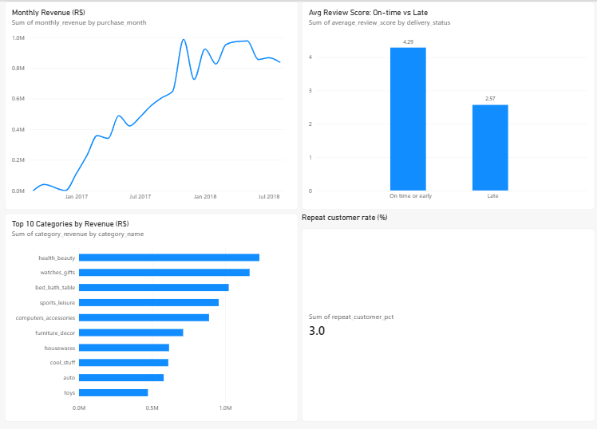

# Olist Brazilian E-commerce Analysis

## Project overview

This project analyzes the Olist Brazilian e-commerce marketplace to understand sales performance, product categories, repeat purchasing, customer segments, and the relationship between delivery lateness and review scores.

It uses Python and pandas to load and check the data, SQLite for SQL analysis, and Power BI for a one-page dashboard with four visuals.

## Business questions

1. How do monthly delivered item revenue and average order value change over time?
2. Which product categories generate the most delivered item revenue, and how concentrated is revenue among the top 20% of categories?
3. What share of customers place repeat delivered orders, and what do simple RFM customer segments look like?
4. Do late deliveries have lower review scores than on-time or early deliveries?

## Data and metric definitions

The analysis uses these Olist dataset tables: orders, order items, customers, order reviews, order payments, products, and the product category name translation.

- **Revenue:** sum of order-item prices for delivered orders; freight is excluded.
- **Average order value (AOV):** delivered item revenue divided by the number of delivered orders in the month.
- **Customer:** identified by `customer_unique_id`.
- **Repeat customer:** a customer with more than one delivered order in the dataset.
- **Late delivery:** actual customer delivery date is after the estimated delivery date.
- **RFM:** Recency, Frequency, and Monetary measures calculated from delivered orders. Recency and monetary scores use quintiles; frequency uses explicit bands (one order = 1, two orders = 4, three or more = 5) because most customers have one delivered order. The segment names are simple project definitions, not official Olist labels.

## Approach

1. Loaded the seven CSV files into `olist.db` with pandas and SQLite.
2. Checked row counts, key uniqueness, missing delivery dates and product categories, and whether fact rows had matching order/product/customer records.
3. Wrote SQL queries using common table expressions, joins, aggregations, and window functions to answer the four business questions.
4. Exported query results to CSV files for Power BI.
5. Built a one-page Power BI dashboard with four visuals to present monthly sales trends, top categories, repeat customer rate, and delivery-related review scores.

## Key findings

- Delivered item revenue peaked at **R$987,765.37** across **7,289 orders** in November 2017; AOV that month was **R$135.51**.
- The top **15 of 74 categories** (approximately 20%) generated **76.34%** of delivered item revenue. `health_beauty` was the highest-revenue category at **R$1,233,131.72**.
- **2,801 of 93,358 delivered customers** were repeat customers, a repeat-customer rate of **3.0%**.
- The simple RFM analysis classified **8,064 customers** as **At risk**.
- Average review score was **2.57** for late deliveries and **4.29** for on-time or early deliveries, a **1.72-point difference**. This is an observed association and does not establish that lateness caused lower scores.

## Data quality and analysis challenges

- Orders can have multiple item rows, payment rows, and review rows. Joining these tables directly can multiply records and overstate metrics. Monthly revenue aggregates item revenue by order before calculating order metrics; customer analyses also aggregate item revenue by order first. The delivery comparison averages reviews to one score per order. The category analysis joins each item to its order and product, without joining the multi-row payment or review tables.
- The source contains **8 delivered orders without an actual delivery date**; these cannot be classified as late or on time and were excluded from the delivery-score comparison.
- **610 products** have no category, and **13 non-null product categories** have no English translation. Missing category values are retained under a visible placeholder instead of silently dropping their revenue.
- There were no unmatched order/customer, item/order, item/product, payment/order, or review/order records in the relationship checks.

## Project files

```text
data/raw/          Original Olist CSV files
scripts/           Python loading, checking, SQL-running, and export scripts
sql/               SQL queries for the four business questions
exports/           CSV query results used by Power BI
olist.db           SQLite database
Olist-Marketplace-Analytics.pbix   Power BI report
dashboard.png      Dashboard screenshot
```



## Reproducing the analysis

Install the Python dependency:

```powershell
python -m pip install -r requirements.txt
```

Place the seven source CSV files in `data/raw/`, then load them into SQLite and run the data checks:

```powershell
python scripts\load_to_sqlite.py
python scripts\check_data.py
```

Run an individual SQL analysis, for example:

```powershell
python scripts\run_sql.py sql\question_1_monthly_revenue.sql
```

Export all analysis results for Power BI:

```powershell
python scripts\export_for_power_bi.py
```


